<!--
SPDX-FileCopyrightText: Simon A. F. Lund <os@safl.dk>

SPDX-License-Identifier: LGPL-2.1-only
-->

# senfd and sate

> [!CAUTION]
> senfd is experimental and is not endorsed by NVM Express. Its data model
> is derived from the NVMe specifications, and you must be a member of NVM
> Express, Inc. to make it or use it. Read the [notices](#notices) first.

**senfd** reads the NVMe specifications, the PDFs NVM Express publishes or
the `.docx` its members hold, and makes a data model of them: every command
with its dwords and fields, every data structure, register, feature, log page
and table of values, each fact citing the document, section, figure and page
it is from.

The data model is JSON validated by a schema, and the same documents give
the same data model every time.

**sate** is an expert with the knowledge of that data model. Ask it about a
command, a field, a register, a feature or a log page, in a session with
completion or on the command line, and it answers at once, citing the figure
with a link to its page of the specification on nvmexpress.org, to check the
answer against:

## What the data model is for

* **Precise answers, at once.** `sate` and `senfd-query` answer a question
  about a command, a field, a register, a feature or a log page in
  milliseconds; see [the expert](https://safl.dk/senfd/sate/).
* **Language models that cannot make NVMe facts up.** `sate-mcp` gives a
  coding agent the data model as tools, and `sate --llm` has a small
  language model on your own CPU choose the lookup and write nothing of the
  answer; see [with a language model](https://safl.dk/senfd/llm/).
* **Code generated from the figures.** An early prototype writes xNVMe's
  specification headers from the data model, every member citing its
  figure; see [code from the figures](https://safl.dk/senfd/codegen/).
* **A linter of the documents.** What does not read as data is listed with
  its figure and page, for the authors to fix; see
  [the linter](https://safl.dk/senfd/linting/).

The [documentation](https://safl.dk/senfd/) has the rest: how to
[install](https://safl.dk/senfd/install/) senfd, or run it from its
[container image](https://safl.dk/senfd/install/#in-a-container),
[make the data model](https://safl.dk/senfd/usage/) from the specifications
NVM Express publishes, [lint the documents](https://safl.dk/senfd/linting/),
[ask the expert](https://safl.dk/senfd/sate/), and use it
[with a language model](https://safl.dk/senfd/llm/). The
[benchmark](https://safl.dk/senfd/benchmark/) shows what it gets right, and
what language models get wrong from memory; [prior art](https://safl.dk/senfd/prior-art/)
tells where senfd comes from, and [the names](https://safl.dk/senfd/names/)
what they mean.

## Notices

**Not endorsed by NVM Express.** senfd is an independent project. It is not
endorsed by NVM Express, Inc., nor made by it, and its data model is not a
publication of NVM Express. NVM Express and NVMe are trademarks of NVM
Express, Inc.

**Experimental: use at your own risk.** senfd is young, what it says can be
wrong, and nothing it says replaces the specification. Every answer cites the
figure it is from: check it there before you rely on it.

**Derived from the specifications, and under their terms.** The data model
senfd makes is derived from the NVMe specifications, so the notice printed in
each specification governs it as it governs the specification. Members of NVM
Express, Inc. may use it subject to their Participation Agreement and the
Company's Intellectual Property Policy and Bylaws. To anyone else, the notice
grants only the right to review, refer to or cite the specification, and
not to make derivatives of it or implement it: **you must be a member of NVM
Express, Inc. to make the data model or make use of it.**

**The specifications are NVM Express's,** under its copyright. NVM Express
publishes the ratified specifications as PDF, which anyone can download from
nvmexpress.org, and senfd reads those. The `.docx` of the specifications
are available to members of NVM Express only; senfd reads those too, for
those who hold them, and gives the same data model of either. The `.docx`
is the simpler source, as it states what the PDF only shows, and it is the
one an editor has while a specification is under revision: run on the
draft, `senfd-query lint` lists what does not read as data, for the
figure to be corrected before it is ratified rather than after.

**Neither the documents nor anything made from them is distributed with
senfd.** Its examples and most of its tests use synthetic documents of its
own. The tests that read the specifications, and the CI job checking what
senfd makes of each, download the public PDFs from nvmexpress.org into a
cache, checked by their SHA-256, and upload neither them nor the data model
made of them, which the job merges and has `sate` answer the benchmark's
questions from, failing unless every one is right. **Make your own**: made
as the documentation shows, from the public PDFs, it is the same data model
the CI job checks.
