.. SPDX-FileCopyrightText: Simon A. F. Lund <os@safl.dk>
..
.. SPDX-License-Identifier: LGPL-2.1-only

senfd and sate
==============

.. image:: https://github.com/safl/senfd/actions/workflows/bd.yaml/badge.svg
    :target: https://github.com/safl/senfd/actions/workflows/bd.yaml
    :alt: Build and test

.. image:: https://coveralls.io/repos/github/safl/senfd/badge.svg?branch=main
    :target: https://coveralls.io/github/safl/senfd?branch=main
    :alt: Coverage

.. image:: https://img.shields.io/pypi/v/senfd
    :target: https://pypi.org/project/senfd/
    :alt: PyPI

.. image:: https://img.shields.io/pypi/pyversions/senfd
    :target: https://pypi.org/project/senfd/
    :alt: Python versions

.. image:: https://img.shields.io/badge/docs-safl.dk%2Fsenfd-blue
    :target: https://safl.dk/senfd/
    :alt: Documentation

.. image:: https://img.shields.io/badge/license-LGPL--2.1--only-blue
    :target: https://spdx.org/licenses/LGPL-2.1-only.html
    :alt: License

.. image:: https://img.shields.io/badge/REUSE-compliant-green
    :target: https://reuse.software/
    :alt: REUSE compliant, checked by pre-commit in CI

.. image:: https://img.shields.io/endpoint?url=https://raw.githubusercontent.com/astral-sh/ruff/main/assets/badge/v2.json
    :target: https://github.com/astral-sh/ruff
    :alt: Ruff

.. image:: https://img.shields.io/badge/types-mypy-blue
    :target: https://mypy-lang.org/
    :alt: Checked with mypy

.. image:: https://img.shields.io/badge/MCP-server-8A2BE2
    :target: https://safl.dk/senfd/sate/
    :alt: MCP server

**senfd** reads the NVMe specifications, the PDFs NVM Express publishes or
the ``.docx`` its members hold, and makes a data model of them: every command
with its dwords and fields, every data structure, register, feature, log page
and table of values, each fact citing the document, section, figure and page
it is from.

         normalise, define and merge, into one data model

The data model is JSON validated by a schema, and the same documents give
the same data model every time.

**sate** is an expert with the knowledge of that data model. Ask it about a
command, a field, a register, a feature or a log page, in a session with
completion or on the command line, and it answers at once, citing the figure
with a link to its page of the specification on nvmexpress.org, to check the
answer against:

         in 2026, and sate answering three questions from it
   :target: https://safl.dk/senfd/

.. warning::

   senfd is not endorsed by NVM Express, it is experimental, and you must be
   a member of NVM Express, Inc. to make its data model or make use of it.
   Read the `notices`_ at the end first.

Use
---

.. code-block:: console

   $ pipx install senfd
   $ senfd ~/specs/*.pdf --output ~/.cache/senfd
   $ senfd-query lint
   $ sate "Which bits of CDW12 of Write are PRINFO?"

with the eleven specifications ratified in 2026 downloaded from
`nvmexpress.org <https://nvmexpress.org/specifications/>`_ into
``~/specs``. The documentation has a page for each step: `install
<https://safl.dk/senfd/install/>`_, `make the data model
<https://safl.dk/senfd/usage/>`_, `lint the documents
<https://safl.dk/senfd/linting/>`_, `ask the expert
<https://safl.dk/senfd/sate/>`_, and `with a language model
<https://safl.dk/senfd/llm/>`_.

What it gets right
------------------

Asked 71 questions with one exact answer each, an opcode, an identifier, a
status code, a bit or a byte offset, mostly about what the revisions
ratified in 2026 added or moved:

* ``sate``, by the words of the question: **71 of 71 right**, in 4 ms
  each, for free.
* ``sate`` with Llama 3.1 8B on a CPU choosing the lookup: **70 of 71
  right, none wrong**, one not known, in 2.7 s each, for free, on your own
  hardware.
* Claude Opus 5.5 and Sonnet 5.5, from memory and told to answer: **15.3
  and 32.3 wrong** on average, stated as surely as the right ones, at USD
  0.10 and 0.02 a run and 0.66 s and 0.13 s a question.

The `benchmark <https://safl.dk/senfd/benchmark/>`_ shows every answer, and
how to run it again. senfd is the third tool of its line, after
`nvme-lint <https://github.com/linux-nvme/nvme-lint>`_ and `Spex
<https://github.com/SamsungDS/Spex>`_; the `documentation
<https://safl.dk/senfd/prior-art/>`__ says what it changed.

The names
---------

senfd reads the **S**\ pecification documents, **E**\ xtracts and
**N**\ ormalises their **F**\ igures, and makes a **D**\ ata model.
``sate`` is **S**\ enfd **A**\ sk **T**\ he **E**\ xpert. *Senf* is
Danish for mustard, as the logo's documents drenched in it show, and a sate
is what comes of the marinade.

Notices
-------

**Not endorsed by NVM Express.** senfd is an independent project. It is not
endorsed by NVM Express, Inc., nor made by it, and its data model is not a
publication of NVM Express. NVM Express and NVMe are trademarks of NVM
Express, Inc.

**Experimental: use at your own risk.** senfd is young, what it says can be
wrong, and nothing it says replaces the specification. Every answer cites the
figure it is from: check it there before you rely on it.

**Derived from the specifications, and under their terms.** The data model
senfd makes is derived from the NVMe specifications, so the notice printed in
each specification governs it as it governs the specification. Members of NVM
Express, Inc. may use it subject to their Participation Agreement and the
Company's Intellectual Property Policy and Bylaws. To anyone else, the notice
grants only the right to review, refer to or cite the specification, and
not to make derivatives of it or implement it: **you must be a member of NVM
Express, Inc. to make the data model or make use of it.**

**The specifications are NVM Express's,** under its copyright. NVM Express
publishes the ratified specifications as PDF, which anyone can download from
nvmexpress.org, and senfd reads those. The ``.docx`` of the specifications
are available to members of NVM Express only; senfd reads those too, for
those who hold them, and gives the same data model of either. The ``.docx``
is the simpler source, as it states what the PDF only shows, and it is the
one an editor has while a specification is under revision: run on the
draft, ``senfd-query lint`` lists what does not read as data, for the
figure to be corrected before it is ratified rather than after.

**Neither the documents nor anything made from them is distributed with
senfd.** Its examples and most of its tests use synthetic documents of its
own. The tests that read the specifications, and the CI job checking what
senfd makes of each, download the public PDFs from nvmexpress.org into a
cache, checked by their SHA-256, and upload neither them nor the data model
made of them, which the job merges and has ``sate`` answer the benchmark's
questions from, failing unless every one is right. **Make your own**: the
commands above give the same data model the CI job checks.
