.. SPDX-FileCopyrightText: Simon A. F. Lund <os@safl.dk>
..
.. SPDX-License-Identifier: LGPL-2.1-only

senfd and sate
==============

**senfd** reads the NVMe specifications, the PDFs NVM Express publishes or
the ``.docx`` its members hold, and makes a data model of them: every command
with its dwords and fields, every data structure, register, feature, log page
and table of values, each fact citing the document, section, figure and page
it is from.

         normalise, define and merge, into one data model

The data model is JSON validated by a :ref:`schema <sec-schema>`, and the
same documents give the same data model every time.

**sate** is an expert on the subject a data model describes. Here that is
the data model senfd makes of the NVMe specifications, as above. Ask it
about a command, a field, a register, a feature or a log page, in a session
with completion or on the command line, and it answers at once, citing the
figure with a link to its page of the specification on nvmexpress.org, to
check the answer against:

.. raw:: html

   

     

       <button role="tab" aria-selected="true" data-cast="session">Interactive</button>
       <button role="tab" aria-selected="false" data-cast="intro">Scripted</button>
     

     

     

   

.. caution::

   senfd is experimental and is not endorsed by NVM Express. Its data model
   is derived from the NVMe specifications, and you must be a member of NVM
   Express, Inc. to make it or use it. Read the :ref:`notices <sec-notices>`
   at the end of this page first.

To use senfd and sate: :ref:`install <sec-install>`, :ref:`make the data
model <sec-usage>`, :ref:`lint the documents <sec-linting>`, :ref:`ask the
expert <sec-ask>`, and, if you like, use it :ref:`with a language model
<sec-llm>`.

What it gets right
------------------

Asked 71 questions with one exact answer each, mostly about what the
revisions ratified in 2026 added or moved, ``sate`` answered all 71 right,
in 4 ms each. With Llama 3.1 8B on a CPU choosing the lookup, it answered
70 and said of one that it is not known. Claude Opus 5.5 and Sonnet 5.5,
from memory and told to answer, got 15.3 and 32.3 wrong on average, stated
as surely as the right ones. The :ref:`benchmark <sec-benchmark>` shows
every answer.

What the data model is for
--------------------------

* **Precise answers, at once.** ``sate`` answers a
  question about a command, a field, a register, a feature or a log page in
  milliseconds; see :ref:`the expert <sec-ask>`.
* **Language models that cannot make NVMe facts up.** ``sate-mcp`` gives a
  coding agent the data model as tools, and ``sate --llm`` has a small
  language model on your own CPU choose the lookup and write nothing of the
  answer; see :ref:`with a language model <sec-llm>`.
* **Code generated from the figures.** An early prototype writes xNVMe's
  specification headers from the data model, every member citing its
  figure; see :ref:`code from the figures <sec-codegen>`.
* **A linter of the documents.** What does not read as data is listed with
  its figure and page, for the authors to fix; see :ref:`the linter
  <sec-linting>`.

.. _sec-notices:

Notices
-------

**Not endorsed by NVM Express.** senfd is independent of NVM Express, Inc.
NVM Express and NVMe are its trademarks.

**Experimental.** What senfd says can be wrong. Every answer cites the
figure it is from; check it there before you rely on it.

**The data model is under the specifications' terms.** It is derived from
the NVMe specifications, so the notice printed in each governs it. Members
of NVM Express, Inc. may use it under their Participation Agreement and the
Company's Intellectual Property Policy and Bylaws; to anyone else, the
notice grants only the right to review, refer to or cite the
specification. **You must be a member of NVM Express, Inc. to make the data
model or use it.**

**Nothing made from the specifications is distributed.** senfd ships no
specification and no data model, and its CI job, which reads the public
PDFs, uploads nothing made from them. Make your own from the public PDFs,
as :ref:`making the data model <sec-usage>` shows.

.. toctree::
   :caption: Use
   :hidden:

   install/index.rst
   usage/index.rst
   linting/index.rst
   sate/index.rst
   llm/index.rst

.. toctree::
   :caption: How it works
   :hidden:

   stages/index.rst
   schema/index.rst
   codegen/index.rst
   prior-art/index.rst

.. toctree::
   :caption: Project
   :hidden:

   contributors/index.rst
   names/index.rst

.. raw:: html

   <link rel="stylesheet" href="https://cdn.jsdelivr.net/npm/asciinema-player@3.9.0/dist/bundle/asciinema-player.css">
   
   
   
